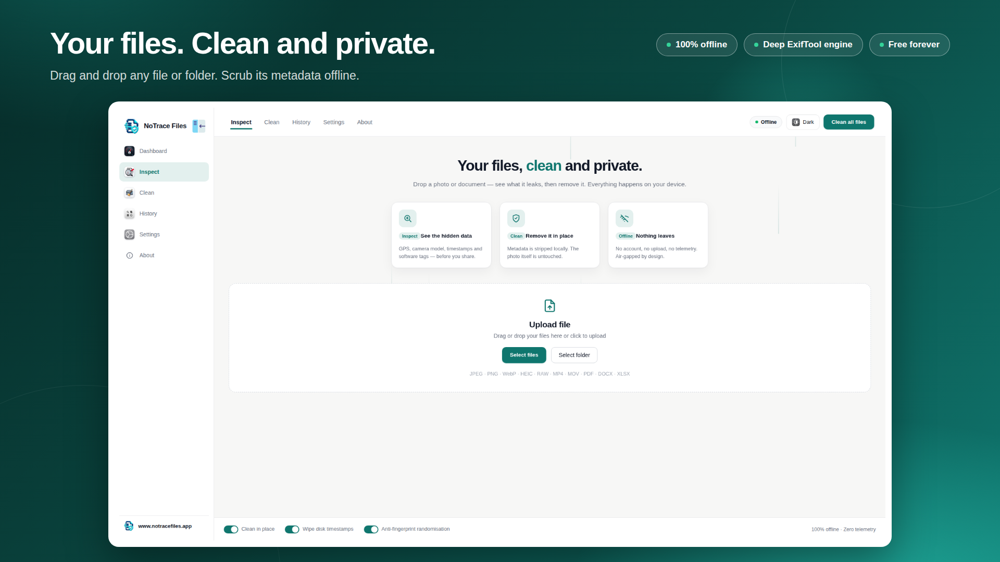
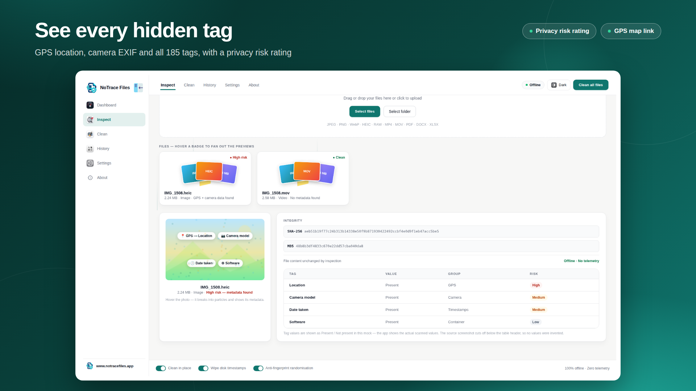
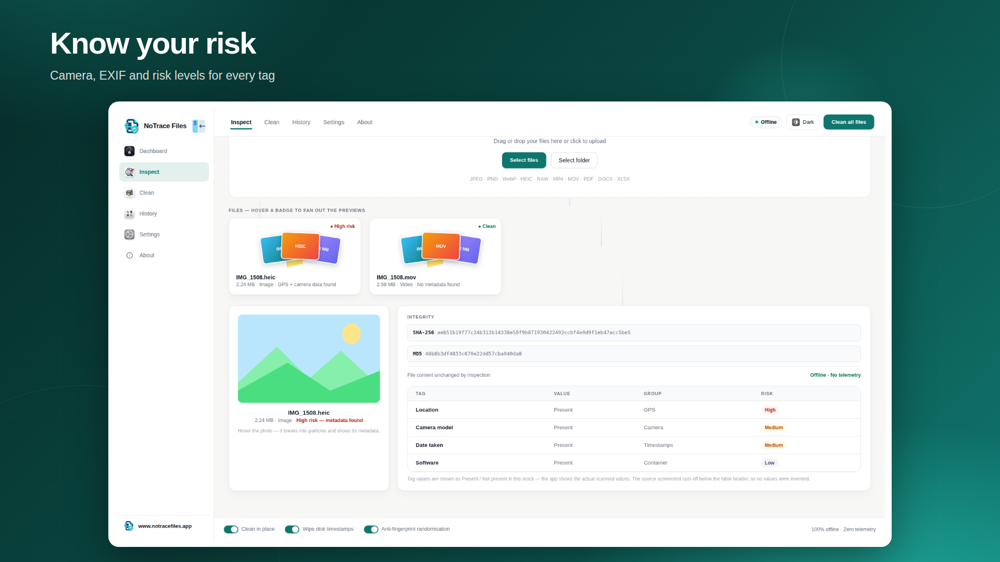
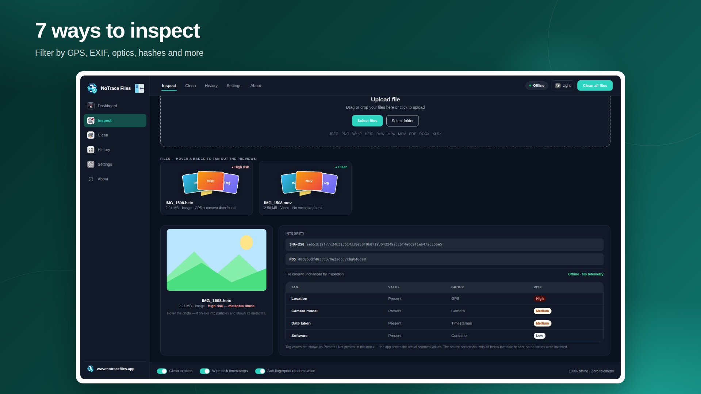
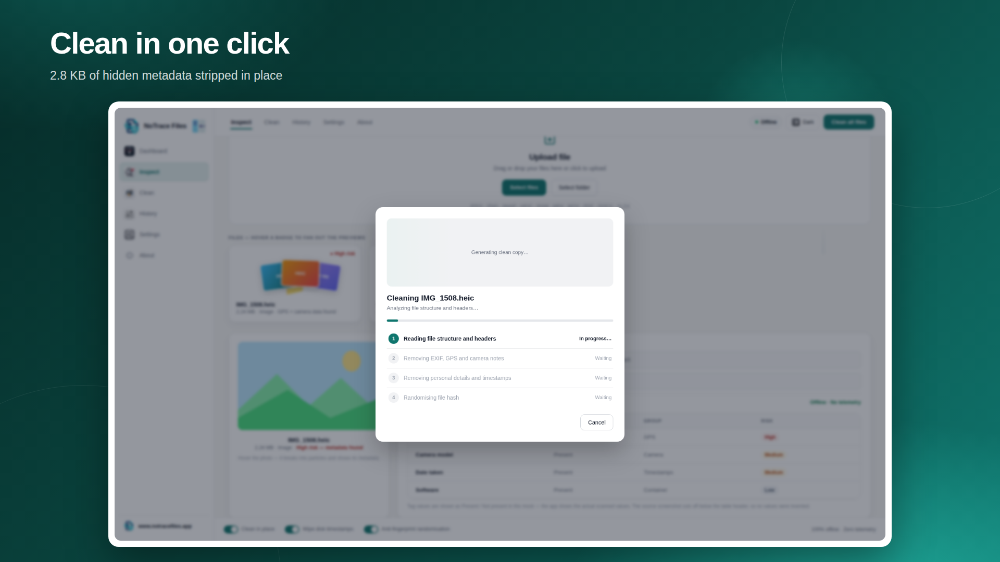
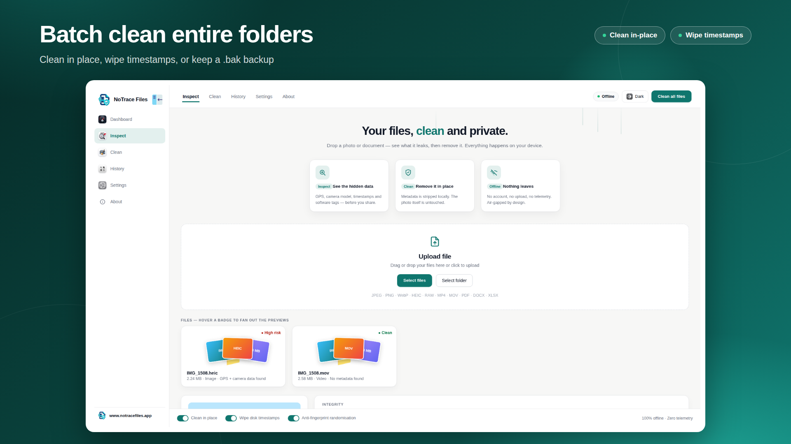

# NoTrace Files

### Your Files, Clean and Private.
**Free, 100% offline metadata viewer and cleaner for Windows & Android.**

 

### 🌐 Direct Downloads Available at: [**notracefiles.app**](https://notracefiles.app/) &nbsp;•&nbsp; [**notracefilesphotoprivacy.apk.com**](https://notracefilesphotoprivacy.apk.com/)

[**Windows Setup Installer (.exe)**](https://github.com/sadiqtbh/notracefiles/releases/download/v2.0.3/NoTrace_Files_Setup.exe) &nbsp;•&nbsp; [**Microsoft Store (.msix)**](https://github.com/sadiqtbh/notracefiles/releases/download/v2.0.3/NoTraceFiles-2.0.3.msix) &nbsp;•&nbsp; [**Portable Standalone (.exe)**](https://github.com/sadiqtbh/notracefiles/releases/download/v2.0.3/NoTrace_Files.exe) &nbsp;•&nbsp; [**Android APK (Direct)**](https://notracefilesphotoprivacy.apk.com/) &nbsp;•&nbsp; [**APKPure**](https://apkpure.com/p/info.sadiqtbh.notracefiles)

---

## 🌟 Overview

Every photo and document you create carries hidden metadata: **exact GPS coordinates, device serial numbers, camera settings, editing timestamps, author names, and software fingerprints**. Share that file online, and you inadvertently share that private data with anyone who downloads it.

**NoTrace Files** inspects your files with the industry-standard deep ExifTool engine, reveals every hidden tag with an intuitive privacy risk score, and strips sensitive data in one click—**100% offline, directly on your device.**

---

## 📸 Application Visual Showcase ([Official Store Listing](https://apps.microsoft.com/detail/9N2R2KZL33NG))

### 1. Drag & Drop Inspection
*Drag and drop any photo or document to inspect its contents offline.*

  

### 2. See Every Hidden Tag & GPS Risk Score
*Reveals camera EXIF, exact GPS coordinates, creation timestamps, and privacy risk ratings.*

  

### 3. Clear Risk Analysis
*Visual indicators alert you to high-risk tags like embedded location and camera identifiers.*

  

### 4. Deep ExifTool Cleaning Engine
*Thoroughly scrubs metadata across images (JPEG, PNG, WebP, HEIC, RAW), videos (MP4, MOV), and office documents (PDF, DOCX, XLSX).*

  

### 5. Flexible Cleaning: In-Place or Copy
*Choose in-place cleaning for zero leftover files, create an optional .bak backup, or save cleaned copies.*

  

### 6. Batch Clean Entire Folders
*Process hundreds of photos simultaneously before publishing albums or sending attachments.*

---

## ✨ Key Superpowers

- 🔍 **Deep ExifTool Engine**: Detects every hidden EXIF, IPTC, XMP, GPS, and camera tag across all major media formats.
- 📍 **GPS Exposure Alert**: Immediately detects embedded location coordinates and flags them before you upload photos to social media or public forums.
- 📁 **Folder Batch Processing**: Drag an entire folder of photos or documents to scrub all metadata in seconds.
- 🔄 **Safe Cleaning Modes**: Keep your original files by saving cleaned copies, or scrub in place with automatic timestamp wiping.
- 🔒 **100% Offline & Private**: Zero telemetry, zero accounts, zero network requests. Your files never leave your computer or phone.
- 🆓 **Free Forever**: No subscriptions, no ads, no paywalls.

---

## 📦 Downloads & Packages

| Platform | Package | Architecture | Description | Link |
| :--- | :--- | :---: | :--- | :--- |
| **Windows** | `NoTrace_Files_Setup.exe` | x64 | **Standard Windows Installer** with setup wizard | [Download](https://github.com/sadiqtbh/notracefiles/releases/download/v2.0.3/NoTrace_Files_Setup.exe) |
| **Windows** | `NoTraceFiles-2.0.3.msix` | x64 | **Microsoft Store / MSIX Package** (v2.0.3.0) | [Download](https://github.com/sadiqtbh/notracefiles/releases/download/v2.0.3/NoTraceFiles-2.0.3.msix) |
| **Windows** | `NoTrace_Files.exe` | x64 | **Portable Standalone App** (runs instantly, no install) | [Download](https://github.com/sadiqtbh/notracefiles/releases/download/v2.0.3/NoTrace_Files.exe) |
| **Windows** | Microsoft Store | x64 | Official certified listing on the Microsoft Store | [Get from Microsoft](https://apps.microsoft.com/detail/9N2R2KZL33NG) |
| **Android** | Direct APK | Mobile | Fast direct APK download | [notracefilesphotoprivacy.apk.com](https://notracefilesphotoprivacy.apk.com/) |
| **Android** | APKPure Listing | Mobile | Download via APKPure | [APKPure](https://apkpure.com/p/info.sadiqtbh.notracefiles) |
| **Media Kit** | `NoTraceFiles-2.0.3-Screenshots.zip` | All | Full-resolution screenshot bundle (`1920×1080`) | [Download Screenshots](https://github.com/sadiqtbh/notracefiles/releases/download/v2.0.3/NoTraceFiles-2.0.3-Screenshots.zip) |

---

## ⚡ What's New in Version 2.0.3

- **Microsoft Partner Center Compliance**: Package version incremented to `2.0.3.0` for store release.
- **Enhanced Startup & Memory Optimization**: Faster app launch and reduced runtime footprint during deep inspection scans.
- **Enhanced WebView2 Rendering Engine**: Optimized interface rendering with smooth transitions and crisp high-DPI scaling.
- **Unified 3D Shield Branding**: Embedded high-resolution icon across Windows desktop, taskbar, and Store tiles.
- **Installer Improvements**: Resolved file locking edge cases during clean in-place upgrades.

---

## 👨‍💻 Developer & Attribution

Developed by **Yeasin Arafat Sadiq**  
🌐 **Website**: [https://notracefiles.app/](https://notracefiles.app/)  
🏬 **Microsoft Store**: [NoTrace Files on Microsoft Store](https://apps.microsoft.com/detail/9N2R2KZL33NG)  
📱 **APKPure**: [NoTrace Files on APKPure](https://apkpure.com/p/info.sadiqtbh.notracefiles)  
📲 **Android Portal**: [https://notracefilesphotoprivacy.apk.com/](https://notracefilesphotoprivacy.apk.com/)
